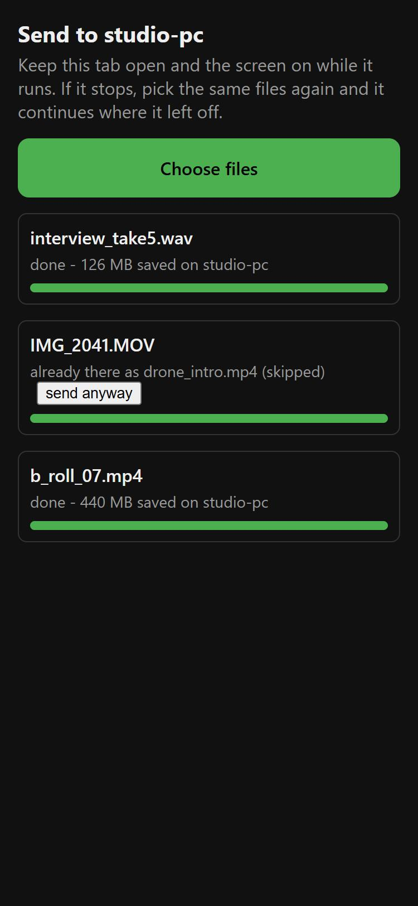

# dropdock

Send big files to a computer from any browser on your network. It resumes after a dropped connection, runs as fast as your network allows, and skips files the computer already has.

You run dropdock on the computer that should receive the files, then open the link it prints on your phone, laptop or tablet and pick files. Nothing has to be installed on the sending device, and dropdock itself needs nothing beyond Python.

<p align="center"></p>

## Why

AirDrop, Taildrop, Nearby Share and the cloud tend to fail on the files that matter most, such as a 40 GB concert recording or a day of camera cards. dropdock was built for exactly those:

- **Resumable.** Files go up in 16 MB pieces. If Wi-Fi drops, the phone sleeps or the tab reloads, pick the same files again and only the missing pieces are sent.
- **Fast.** Four pieces are in flight at once over kept-alive connections. A phone on a USB-C Ethernet adapter reached about 90–99 MB/s on gigabit; Wi-Fi gets whatever the Wi-Fi gives.
- **No duplicates.** Before uploading, the page asks the computer whether it already has each file. It compares the size and 12 sampled blocks, against any folder you choose. Files it already has are marked "already there", with a "send anyway" button.
- **Safe to finish.** A file only appears in the folder once every piece has arrived. Partial data waits in `.partial/` until then.
- **Locked down.** Only the devices or networks you allow can connect, and every request needs the secret link.
- **No dependencies.** It's one Python file using only the standard library, plus an optional window to start it.

## Install

You need Python 3.10 or newer on the receiving computer.

```
pip install git+https://github.com/GustafMos/dropdock
```

Or skip installing: [`dropdock/server.py`](dropdock/server.py) runs on its own (`python server.py --help`).

## Use it with the window

```
dropdock
```

1. **Choose the folder** the files go into. Optionally choose a folder to check for files you already have; leave it empty to switch the check off.
2. **Tick the devices** that may send. The window lists the devices it finds on your local network and your Tailscale devices. If a device isn't listed, start anyway and open the link on it: the window asks whether to let it in.
3. **Press Start** and open the link on the other device. You can copy it with the Copy button.

Settings, including the link, are remembered between runs. The link stays the same until you press **New link**.

## Use it in a terminal

```
dropdock serve --allow 192.168.1.0/24 --dest ~/Downloads/dropdock
```

| Option | Meaning |
|---|---|
| `--allow` | Device address or network that may connect, e.g. `192.168.1.50`, `192.168.1.0/24`, `100.64.0.0/10` (Tailscale). Repeatable and required. |
| `--dest` | Folder the files are saved into. |
| `--library` | Folder searched for files you already have (default: `--dest`; `none` turns the check off). |
| `--bind` | Address to listen on (default: all of them). Repeatable. |
| `--port` | Port, default 8765. |
| `--key` | The secret part of the link (default: a new random one each run). |
| `--name` | Name shown on the page (default: the computer's name). |

The server prints one link per network address of the computer. Open the one that's on the same network as the sending device.

## Tips

- **Phones: use Chrome or Samsung Internet.** Firefox for Android copies every picked file into its own storage before the page can read it, which freezes on big files. The page warns you if it sees Firefox on Android.
- **Keep the screen on** while a big upload runs. Phones slow down or pause background tabs.
- **Wired is much faster.** A USB-C Ethernet adapter on the phone beats Wi-Fi by a wide margin, and dropdock can use it.
- **Firewall:** the first time, your OS may ask whether Python may accept incoming connections. Allow it for the network you're on.

## Security

- dropdock speaks **plain HTTP**. Use it on a network you trust, or over a VPN such as Tailscale or WireGuard, which encrypt the traffic themselves.
- A device needs both an allowed address **and** the secret link. Requests from other addresses are refused, and the window shows them so you can let a device in.
- Uploaded names are reduced to a plain file name, so nothing can be written outside the destination folder. Nothing is ever overwritten: a different file with a name that already exists is saved as `name (2).ext`, and the same file sent twice is kept once.
- Each piece is flushed to disk before it is recorded, so a crash or power cut never leaves a file that claims to be complete but has holes. Files can be up to 4 TB, and the server serves at most 64 connections at once.
- The duplicate check tells the sending device the name of the matching file (relative to the folder you chose), and nothing else about the folder.

## How it works

The page is a single HTML file served by the Python script:

- `POST /check`: the page sends 12 blocks of 64 KB sampled at fixed positions (the whole file if it's smaller). The server looks for a file of the same size whose blocks match.
- `GET /status`: the server answers with the piece size and which pieces are still missing.
- `PUT /put?index=N`: one piece. The server writes it at its offset in `.partial/<name>.<size>.part` and records it in a small JSON sidecar. When the last piece arrives, the file is moved into place.

## Development

```
python -m venv .venv
.venv/bin/pip install pytest -e .     # Windows: .venv\Scripts\pip
.venv/bin/pytest -q
```

dropdock came out of [ShowSync](https://github.com/GustafMos/showsync), a tool for syncing concert footage, where a phone kept failing to send 40 GB files to the editing PC.

---

## Support my cats

If you want to support me and my projects, help me fund tasty anti-allergenic food for my two cats, **Carla-Mittersteig von Starhemberg** and **Rosa-Luxemburg von Starhemberg**. <3 Thank you!

**Ko-fi:** <https://ko-fi.com/ripscorpy> · [FUNDING.md](FUNDING.md)

---

## License

MIT. See [LICENSE](LICENSE).
